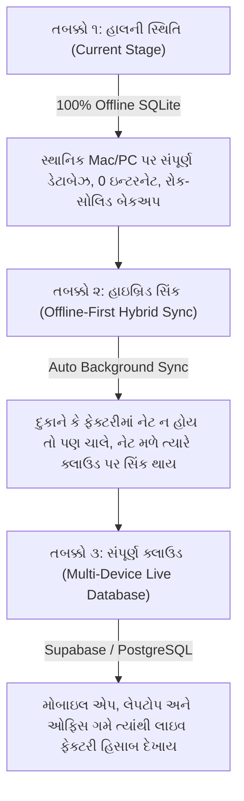

# 🪡 OM MAVTAR GROUP — સિસ્ટમ ફીચર્સ, આવક-ખર્ચ (Income vs Expense) વિશ્લેષણ, વર્તમાન ખામીઓ અને લાઇવ ડેટાબેઝ રોડમેપ

> **દસ્તાવેજ સ્થિતિ:** v1.0.0 Desktop Production Ready  
> **આર્કિટેક્ચર:** 100% Offline SQLite Database (Zero Internet Dependency)  
> **ટેસ્ટ સ્થિતિ:** 145/145 Automated Tests Passed (100% Green) | 0 Flutter Analyze Issues  
> **તારીખ:** 04 નવેમ્બર 2026  

---

## 📑 અનુક્રમણિકા (Table of Contents)
1. [ભાગ ૧: હાલમાં ઉપલબ્ધ તમામ સિસ્ટમ ફીચર્સ (Current Live Features)](#ભાગ-૧-હાલમાં-ઉપલબ્ધ-તમામ-સિસ્ટમ-ફીચર્સ)
2. [ભાગ ૨: આવક અને ખર્ચ (Income vs Expense) ની વર્તમાન સ્થિતિ અને ખામીઓ](#ભાગ-૨-આવક-અને-ખર્ચ-income-vs-expense-વિશ્લેષણ)
3. [ભાગ ૩: 100% પાવરફુલ ઓફલાઇન સિસ્ટમ માટે જરૂરી સુધારાઓ (Offline Gaps & Fixes)](#ભાગ-૩-ઓફલાઇન-સિસ્ટમ-મજબૂતી-માટે-જરૂરી-સુધારાઓ)
4. [ભાગ ૪: ભવિષ્યમાં Live / Cloud Database માં કન્વર્ટ કરવાનો રોડમેપ (Migration Blueprint)](#ભાગ-૪-લાઇવ-ક્લાઉડ-ડેટાબેઝ-રોડમેપ)

---

# ભાગ ૧: હાલમાં ઉપલબ્ધ તમામ સિસ્ટમ ફીચર્સ

હાલમાં સોફ્ટવેરમાં નીચે મુજબના તમામ મોડ્યુલ્સ સંપૂર્ણપણે કાર્યરત (Fully Functional & Tested) છે:

### ૧. પ્રોડક્શન એન્ટ્રી અને કોર કેલ્ક્યુલેશન એન્જિન (Production Entry & 3-Step Math)
- **સચોટ ૩-સ્ટેપ ગણતરી ફોર્મ્યુલા:**
  1. $\text{Final Stitch} = \frac{\text{Total Stitch}}{1000}$
  2. $\text{Stitch Rate Amount} = \text{Final Stitch} \times \text{Rate}$
  3. $\text{Final Total Production Value} = \text{Stitch Rate Amount} \times \text{Machine Heads}$
- **તારીખ અને ઓડિટ સમયનું સ્પષ્ટ વિભાજન:**
  - કામ કરવાની મૂળ તારીખ (`date`) અને રેકોર્ડ બનવાનો સિસ્ટમ સમય (`created_at`) અલગ રાખેલ છે.
  - ટાઇમ પીકર દૂર કરી શિફ્ટ (**Day ☀️ / Night 🌙**) સરળ બનાવી છે.
- **ફાસ્ટ ડેઇલી શિફ્ટ બેચ એન્ટ્રી મેટ્રિક્સ (Batch Matrix M-01 to M-08):**
  - એક જ ક્લિકમાં શિફ્ટ મુજબ બધી મશીનોનો સ્ટીચ ડેટા એકસાથે એન્ટર કરવાની સુવિધા.
  - મશીન નંબર મેન્યુઅલી પસંદ / બદલવાની સ્વતંત્રતા.
- **બધા ટેબલ્સમાં ડેટા સોર્ટિંગ (Ascending / Descending Sorting):**
  - ટેબલના દરેક કોલમ હેડર (#No, Date, Machine No, Total Stitch, Rate, Amount) પર ક્લિક કરવાથી ચડતા કે ઊતરતા ક્રમમાં ડેટા ગોઠવાય છે.
- **Show All અને 50+ પેજીનેશન:**
  - 10, 25, 50 ની સાથે "Show All" ચેકબોક્સ જેથી ગમે તેટલા રેકોર્ડ્સ એકસાથે જોઈ શકાય.

### ૨. મશીન અને ખાતા માસ્ટર (Machines & Khata Masters)
- **મશીનો (M-01 થી M-08+):**
  - મશીન નામ, હેડ કેપેસિટી (12, 14, 15, 16, 24, 30, 32 Heads) અને એક્ટિવ/ઇન-એક્ટિવ સ્ટેટસ.
- **ખાતાબહી (Accounts / Categories):**
  - ૨૫૦ એરિયા (250 Area), ૪૦૦ એરિયા (400 Area), બીડ્સ (Beads) તેમજ કસ્ટમ ખાતાઓ.
  - કલર કોડિંગ અને ડિસ્પ્લે ઓર્ડર.

### ૩. કાચો માલ ખરીદી અને સપ્લાયર ચલણ લેજર (Raw Material Purchases Ledger)
- **સ્પષ્ટ બિઝનેસ ફ્લો:**
  - કંપની દ્વારા કાચો માલ (Sequence, Beads, Thread / Dhaga) સપ્લાયર્સ પાસેથી ખરીદવામાં આવે છે.
  - ચલણ એ કંપનીનું **ખરીદી બિલ (Inward Purchase Bill)** છે.
  - પેમેન્ટ એ કંપની દ્વારા વેપારીને **ચૂકવવાનું છે (Outgoing Accounts Payable)**.
- **૫-મેટ્રિક નાણાકીય કન્સોલ:**
  - કુલ ખરીદી બિલ (Total Purchases ₹), સપ્લાયરને ચૂકવેલ (Paid ₹), ચૂકવવાનું બાકી (Payable Due ₹), કુલ ખરીદી જથ્થો (Inward Stock Qty) અને કુલ ચલણ.
- **સપ્લાયર લેજર અને સ્ટેટમેન્ટ:**
  - સપ્લાયર વાઇઝ ફિલ્ટર, ૧-ક્લિક ચૂકતે (Mark All Paid), PDF અને Excel સ્ટેટમેન્ટ્સ.

### ૪. કર્મચારી પગાર અને ઉપાડ (Employees & Salary Advances)
- **કર્મચારી પ્રોફાઇલ:** ઓપરેટર, માસ્ટર, કારીગર, હેલ્પર, ડિઝાઇનર, ચેકર, મેનેજર.
- **ઉપાડ (Advance Upad) ટ્રેકિંગ:** તારીખ વાઇઝ ઉપાડ હિસાબ, સેટલમેન્ટ અને વ્હોટ્સએપ સ્લિપ મેસેજિંગ.
- **વધારાનો ઉપાડ કેરી-ફોરવર્ડ (Excess Upad Carry-Forward):** જો કારીગરનો ઉપાડ તેના માસિક પગાર કરતાં વધી જાય તો બાકી રહેલો વધારાનો ઉપાડ આપોઆપ આવતા મહિનામાં ટ્રાન્સફર થાય છે.

### ૫. બેકઅપ અને ડેટા સુરક્ષા (Rock-Solid Offline Backup & Restore)
- **૧-ક્લિક બેકઅપ:** સંપૂર્ણ ડેટાબેઝ JSON ફોર્મેટમાં સુરક્ષિત સેવ થાય છે.
- **સ્માર્ટ રીસ્ટોર (Smart Restore Engine):**
  - **સિસ્ટમ ખાલી હોય ત્યારે:** બેકઅપમાંથી તમામ ડેટા સીધો જ (Direct Full Set) પુનઃસ્થાપિત થાય છે.
  - **સિસ્ટમમાં પહેલેથી ડેટા હોય ત્યારે:** સ્માર્ટ મર્જ (Smart Merge) દ્વારા જૂનો ડેટા સચવાય છે અને નવો ડેટા ઉમેરાય છે.

### ૬. રિસાયકલ બિન (Recycle Bin)
- આકસ્મિક રીતે ડિલીટ થયેલા રેકોર્ડ્સ રિસાયકલ બિનમાં સુરક્ષિત રહે છે અને ૧-ક્લિકમાં પાછા લાવી શકાય છે.

---

# ભાગ ૨: આવક અને ખર્ચ (Income vs Expense) વિશ્લેષણ

તમારો પ્રશ્ન: **"શું આમાં કુલ કેટલી આવક થઈ અને કેટલો ખર્ચ થયો તે જાણી શકાય છે? કે હજુ કોઈ ખામી છે?"**

### 📌 વર્તમાન સ્થિતિનો સાચો જવાબ:
**હાલમાં સિસ્ટમમાં આવક અને ખર્ચના મુખ્ય ઘટકો ઉપલબ્ધ છે, પરંતુ સંપૂર્ણ નફો-નુકસાન (Full Net Profit/Loss) જાણવા માટે ૨ મહત્વની બાબતો ખૂટે છે.**

વિગતવાર સમજો:

### ૧. કુલ આવક (Total Income / Production Billing) ની સ્થિતિ:
| આવકનો પ્રકાર | હાલની સિસ્ટમમાં છે? | કેવી રીતે ગણાય છે? |
| :--- | :---: | :--- |
| **ઉત્પાદન કમાણી (Production Stitch Billing)** | ✅ **ઉપલબ્ધ છે** | ડેશબોર્ડ અને એનાલિટિક્સમાં મશીનો દ્વારા થયેલ સ્ટીચના આધારે કુલ રકમ (Total Factory Value ₹) ગણાય છે. |
| **ગ્રાહક પાસેથી જમા પેમેન્ટ (Customer Payment Receipts)** | ❌ **ખામી (Missing)** | ગ્રાહકે (પાર્ટીએ) બિલ સામે કેટલા રૂપિયા રોકડા/ચેક/બેંકમાં આપ્યા અને પાર્ટી પાસે કેટલા રૂપિયા લેવાના બાકી છે (Customer Outstanding Ledger) તે નોંધવાનો વિકલ્પ હાલમાં નથી. |

### ૨. કુલ ખર્ચ (Total Expenses / Outflow) ની સ્થિતિ:
| ખર્ચનો પ્રકાર | હાલની સિસ્ટમમાં છે? | કેવી રીતે ગણાય છે? |
| :--- | :---: | :--- |
| **કાચો માલ ખરીદી ખર્ચ (Raw Material Purchases)** | ✅ **ઉપલબ્ધ છે** | સિક્વન્સ, બીડ્સ, દોરો (Thread) ખરીદીની કુલ રકમ (Total Purchases ₹) અને સપ્લાયરને ચૂકવેલ રકમ ઉપલબ્ધ છે. |
| **કર્મચારી પગાર અને ઉપાડ (Staff Salaries & Advances)** | ✅ **ઉપલબ્ધ છે** | કર્મચારીઓનો માસિક ફિક્સ પગાર અને લીધેલ ઉપાડની રકમ ઉપલબ્ધ છે. |
| **ફેક્ટરી સંચાલન ખર્ચાઓ (General Factory Overheads)** | ❌ **મોટી ખામી (Missing)** | ૧. લાઈટ બિલ (Electricity Power Bill) ૨. મશીન રિપેરિંગ, ઓઇલ અને સ્પેરપાર્ટ્સ ૩. ફેક્ટરી ભાડું (Rent) ૪. ચા-પાણી, નાસ્તો, સ્ટેશનરી (Petty Cash Expenses) ૫. ટેમ્પો/ટ્રાન્સપોર્ટેશન અને દલાલી |

### ૩. નફો-નુકસાન સ્ટેટમેન્ટ (Unified P&L Dashboard):
- ❌ **હાલની ખામી:** અત્યારે પ્રોડક્શન આવક **Dashboard/Analytics** પર છે, માલ ખરીદી ખર્ચ **Materials** પર છે, અને સ્ટાફ પગાર **Employees** પર છે.
- એક જ સ્ક્રીન પર નીચે મુજબની ગણતરી બતાવતું **નફો-નુકસાન કન્સોલ** હાલમાં નથી:
  $$\text{કુલ ચોખ્ખો નફો (Net Profit)} = \text{કુલ ઉત્પાદન આવક} - (\text{કાચો માલ ખરીદી} + \text{સ્ટાફ પગાર} + \text{ફેક્ટરી સામાન્ય ખર્ચા})$$

---

# ભાગ ૩: ઓફલાઇન સિસ્ટમ મજબૂતી માટે જરૂરી સુધારાઓ

તમારે **ઓફલાઇનમાં પૂરી રીતે working system** બનાવવી છે, જેથી ફેક્ટરીનો સંપૂર્ણ હિસાબ કોમ્પ્યુટરમાં ઓફલાઇન જળવાઈ રહે. તે માટે નીચેના ૩ ફિચર્સ ઉમેરવા જોઈએ:

### ૧. સામાન્ય ફેક્ટરી ખર્ચ મોડ્યુલ (Factory Daily Expenses Master):
- **શું ઉમેરવું:** એક નવું મેનુ / સ્ક્રીન: **"ફેક્ટરી ખર્ચાઓ (Expenses)"**.
- **કેટેગરીઝ:**
  - ⚡ લાઈટ બિલ (Electricity)
  - 🔧 મશીન મેન્ટેનન્સ અને ઓઇલ (Repairs & Spares)
  - 🏢 ફેક્ટરી ભાડું (Rent)
  - ☕ ચા-પાણી / પરચૂરણ (Petty Cash)
  - 🚚 ટ્રાન્સપોર્ટ / ટેમ્પો ભાડું
- **ફીલ્ડ્સ:** તારીખ, કેટેગરી, રકમ (₹), પેમેન્ટ મોડ (Cash / Bank / UPI), ચૂકવનાર વ્યક્તિ, વિગત (Notes).

### ૨. નફો-નુકસાન સમરી કન્સોલ (Factory Profit & Loss Report):
- એનાલિટિક્સ અથવા ડેશબોર્ડ પર એક ફાઇનાન્સિયલ કાર્ડ:
  - **કુલ આવક (Total Production Income):** ₹...
  - **કુલ ખર્ચાઓ (Total Factory Expenses):** ₹...
    - માલ ખરીદી: ₹...
    - કારીગર પગાર: ₹...
    - લાઈટ બિલ અને સામાન્ય ખર્ચા: ₹...
  - **ચોખ્ખો નફો (Net Profit / Loss):** ₹...

### ૩. ગ્રાહક લેજર (Party / Customer Payment & Outstanding Ledger):
- કઈ પાર્ટી પાસે કેટલું પ્રોડક્શન કામ થયું અને પાર્ટી પાસેથી કેટલા રૂપિયા આવ્યા / બાકી છે તેની ઓફલાઇન ડાયરી.

---

# ભાગ ૪: લાઇવ / ક્લાઉડ ડેટાબેઝ રોડમેપ

તમારી યોજના: **"પહેલા ઓફલાઇન બધું પરફેક્ટ ચાલવા દો, પછી આગળ જઈને લાઇવ ડેટાબેઝમાં કન્વર્ટ કરવું છે."**

આ વિચાર **૧૦૦% ઉત્તમ અને વ્યવહારુ (Best Industry Practice)** છે!

### શા માટે વર્તમાન કોડ લાઇવ ડેટાબેઝ માટે તૈયાર છે?
1. **ક્લીન રિપોઝીટરી પેટર્ન (Modular Architecture):**
   - કોડમાં UI અને ડેટાબેઝ સીધા જોડાયેલા નથી. વચ્ચે `ProductionProvider` છે.
   - જ્યારે લાઇવ કરવું હોય ત્યારે ફક્ત `DatabaseHelper` ની અંદર SQLite ક્વેરીની જગ્યાએ API / Cloud SDK જોડવાનું રહેશે. UI સ્ક્રીન બદલવી નહીં પડે.
2. **તમામ ટેબલ્સના સ્ટ્રક્ચર રિલેશનલ (Relational Schema) છે:**
   - `accounts`, `machines`, `production_records`, `material_items`, `suppliers`, `employees` બધા પાસે `id`, `date`, `created_at` છે જે PostgreSQL / Supabase સાથે ૧૦૦% સુસંગત છે.

### 🚀 લાઇવ ડેટાબેઝમાં જવાના ૩ તબક્કા (Migration Steps):

#### શ્રેષ્ઠ ટેકનોલોજી ભલામણ (Recommended Cloud Stack):
- **Supabase (PostgreSQL Cloud):** 
  - ફ્લટર માટે ઓફિશિયલ સુવિધા આપે છે.
  - રો-લેવલ સિક્યોરિટી અને રિયલ-ટાઇમ અપડેટ્સ મળે છે.
  - ઓફલાઇન લોકલ ડેટાબેઝ (SQLite) અને ક્લાઉડ વચ્ચે સરળ સિંકિંગ થઈ શકે છે.

---

### 📋 તાત્કાલિક આગામી પગલાં (Summary & Recommendation):
1. **વર્તમાન સિસ્ટમ:** તમારી પાસે પ્રોડક્શન સ્ટીચ આવક, મટીરીયલ ખરીદી ખર્ચ, સ્ટાફ પગાર અને ઉપાડનો હિસાબ **૧૦૦% સચોટ અને લાઇવ વર્કિંગ** છે.
2. **આવક-ખર્ચ ખામી દૂર કરવા માટે:** જો તમે કહો તો આપણે **"ફેક્ટરી ખર્ચાઓ (General Expenses)"** અને **"નફો-નુકસાન સમરી (Income vs Expense Dashboard Card)"** ઉમેરી દઈએ, જેથી ઓફલાઇન જ તમને ફેક્ટરીનો ચોખ્ખો નફો-ખર્ચ દરરોજ દેખાતો થઈ જાય!

